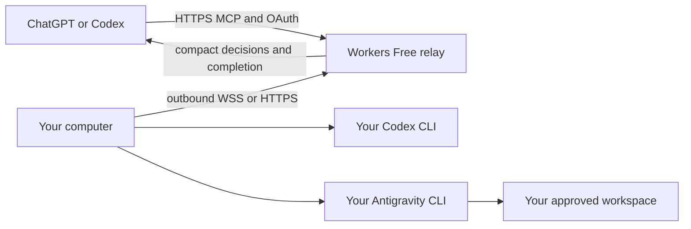

# Delegate to Antigravity HTTPS relay

The remote edition connects ChatGPT or Codex to a computer you run with your own
Codex and Antigravity accounts. The hosted relay handles authentication and a
small mailbox on Cloudflare Workers Free. Inference runs on your computer. No
local MCP listener or inbound worker port is required.

For normal Windows use, follow [computer setup](../companion/README.md) and manage
the headless companion in ChatGPT. Use the version-pinned command shown in
Computers:

```sh
npx --yes https://github.com/ramiradwan/astra-antigravity/releases/download/companion-v0.4.1/delegate-to-antigravity-0.4.1.tgz setup
```

The bootstrap comes from GitHub HTTPS and verifies the signed companion manifest
and installer hash. No npm publishing account is required. The installed
companion has no GUI, tray or local web listener and needs no source checkout,
Node.js, Python or uv. Approve computer management, provider setup and a workspace
separately in ChatGPT. Use its original `--request-id ID` when continuing a saved
first task.



## Run a source-managed worker

Use this option when managing the runtime yourself rather than using the Windows
companion. Install Python 3.11+, uv, Git, Codex CLI and Antigravity CLI. Sign into
the providers normally using your own accounts. Provider terms, models,
subscriptions and quotas apply. Clone this repository and run:

```sh
uv run --python 3.11 --no-project --with-requirements relay/worker-requirements.lock \
  python relay/worker.py init --relay https://YOUR-RELAY-HOST \
  --workspace project=/absolute/path/to/your/git-checkout
```

Open the verification URL printed by `init`. Use the same sign-in method and
account as the plugin, and review the computer and workspace aliases before
approving. The private pairing proof and credential are not printed. Use
`--shared-workspace notes=/path/to/folder` only for direct changes. Git worktree
isolation needs a clean repository with a committed HEAD; it is not an OS sandbox.

```sh
uv run --python 3.11 --no-project --with-requirements relay/worker-requirements.lock \
  python relay/worker.py run
```

The default transport is a hibernating outbound WebSocket. Use `--transport http`
when a proxy permits only HTTPS. Deterministic code waits for transport events;
the parent conversation model does not poll. A source-managed worker exits after
ten minutes with no tasks or pending deliveries. `--idle-timeout 0` disables idle
exit on an always-on computer.

Private state defaults to `~/.local/state/astra-antigravity-relay` and must stay
outside every delegated workspace. Use `--state PATH` consistently for another
private directory. It holds the worker credential, dispatch journal and local
provider evidence. The adapter leaves `CODEX_HOME` unchanged. Stop it before
removing state. A new pairing uses a new state directory; revoke the previous
pairing from the relay's account page.

## Progress, delivery and recovery

The ChatGPT card uses MCP Apps and refreshes outside the conversation model's
context. An active notification indicator means a verified host subscription is
established; generic CLI push is not implied. Hosts without the UI retain bounded
task tools. Ordinary progress stays in the UI, while compact decisions and
terminal results reach compatible hosts.

Published files up to **20 MiB** use host-mediated attachment streaming over the
worker's existing outbound connection. Chunks are flow-controlled and are not
retained in relay file storage. Supported ChatGPT APIs receive the file; hosts
without them show an inline explanation and preserve the result. There is no
browser download fallback. The model-readable legacy export remains limited to
**12,000 bytes**. Neither a transfer request nor a sent file promises permanent
ChatGPT Library storage.

Retain the original request and delegation receipts. Network interruption and
reconnection preserve task identity; inspect saved state before retrying
uncertain work. Pause blocks new tasks while management and delivery remain
available. Stop tasks requests cancellation and waits for acknowledgement.
Cancellation does not undo local changes, and revocation does not prove the
provider stopped.

New computer approval can remain until revoked. Rotating device credentials do
not change that approval or task identity. Existing 30-day approvals retain
their expiry until explicitly converted. See
[connection and recovery](../docs/CONNECTIONS.md),
[privacy](../plugins/astra-antigravity-remote/docs/PRIVACY.md) and
[use conditions](../plugins/astra-antigravity-remote/docs/TERMS.md).
